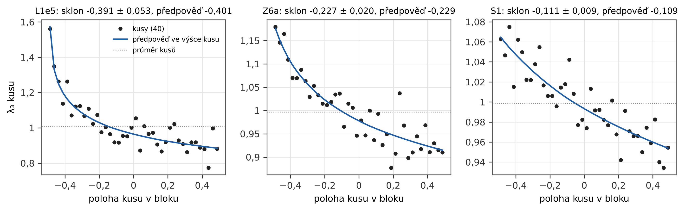

# 1. Úvod

Studie I–III této řady [1–3] měřily párovou korelaci nul Riemannovy funkce zeta a její nasycení (Berry [4]), mimodiagonální členy Bogomolného a Keatinga [5, 6] a jednohladinovou hustotu kvadratických Dirichletových L-funkcí proti domněnce poměrů a limitě Katze a Sarnaka. Přirozenou další statistikou nul jedné L-funkce je tříbodová korelace $R_3$.

V limitě velké výšky je $R_3$ rozvinutých nul tříbodovou funkcí gaussovského unitárního souboru (GUE), determinantem sinového jádra; pro testovací funkce s omezeným nosičem to dokázali Hejhal [7] a Rudnick se Sarnakem [8]. V konečné výšce přibývají členy nižšího řádu, které nesou prvočísla. Bogomolny a Keating [9, 6] je odvodili semiklasicky z Hardyho–Littlewoodovy domněnky; Conrey a Snaithová [10] je odvodili z domněnky poměrů Conreyho, Farmera a Zirnbauera [11] (viz též [12]) až po konstantní člen, ukázali shodu s Bogomolným a Keatingem a výsledek porovnali s prvními $10^5$ nulami. Bogomolny a Keating později podali determinantový tvar, který lze vyčíslit v konečné výšce [13]. Vzorec Conreyho a Snaithové tedy už se s nulami srovnával; tato studie si nemůže nárokovat první test.

Co přidáváme, je rozsah a statistický rámec. Používáme 147 milionů nul spočtených Plattem [14] a šířených databází LMFDB [15] ve 14 blocích od první nuly až po $t = 3{,}06\cdot10^{10}$, ke každému koši připojujeme chybu a srovnáváme pomocí $\chi^2$ a nulových modelů, které části vzorce odebírají. Opakujeme srovnání Conreyho a Snaithové na prvních $10^5$ nulách s chybou každého koše (oddíl 4.1), testujeme vzorec ve všech blocích (4.2), shrnujeme odchylku od GUE jedinou amplitudou a sledujeme ji přes výšku (4.3) a testujeme malé sady mnohem výš, jak nám navrhl S. J. Miller (4.4); ten nás také upozornil, že konvergence je u takových problémů velmi pomalá, a odkázal nás na studii Watkinse [21], které se věnuje oddíl 5. Oddíl 4.5 shrnuje nulové modely a analýzu citlivosti. Oddíl 5 je dodatkem ke studii III v témž duchu: kvadratické L-funkce u $|D| = 10^{12}$. Oddíl 6 uvádí tvrzení a jejich stav, oddíl 7 odděluje nové od potvrzeného, oddíl 8 rozebírá omezení.

# 2. Data

**Nuly funkce zeta.** D. Platt spočetl nuly $\zeta(\tfrac12 + it)$ až do $t \approx 3{,}06\cdot10^{10}$ (103,8 miliardy nul) s rigorózní intervalovou aritmetikou [14]; LMFDB je šíří v binárních souborech s přesností $\pm 2^{-102}$ [15]. Stáhli jsme 30 souborů (147 474 957 nul; kontrolní součty md5 všech souborů ověřeny): nuly č. 1 až 68 276 991 bez mezer ($t \le 2{,}98\cdot10^7$) a po třech po sobě jdoucích souborech u $t \approx 10^8$, $10^9$, $10^{10}$ a $3{,}06\cdot10^{10}$; z nich je vyřezáno 14 bloků tabulky 1. Soubory kontrolujeme navzájem (po sobě jdoucí soubory na sebe přesně navazují), proti funkci počtu nul ($N(t) = \theta(t)/\pi + 1 + S(t)$ s $|S| < 1$ na každé hranici souboru), proti Odlyzkově tabulce prvních 2 001 052 nul (rozdíly pod $3\cdot10^{-9}$) a proti prvním $10^5$ nulám LMFDB (pod $1{,}2\cdot10^{-11}$).

| blok | nul | medián $t$ | $N_{\mathrm{ef}}$ |
|------|-------:|------:|------:|
| L1e5 | 99 983 | $4{,}04\cdot10^4$ | 2,02 |
| Z6a | 899 984 | $3{,}48\cdot10^5$ | 2,51 |
| Z6b | 999 984 | $8{,}70\cdot10^5$ | 2,72 |
| P5e6 | 2 999 984 | $1{,}89\cdot10^6$ | 2,90 |
| S1–S6 | 6 × 10 499 984 | $5{,}1\cdot10^6$ – $2{,}8\cdot10^7$ | 3,13–3,52 |
| H1e8 | 16 649 768 | $1{,}02\cdot10^8$ | 3,82 |
| H1e9 | 18 937 009 | $1{,}00\cdot10^9$ | 4,35 |
| H1e10 | 21 244 828 | $1{,}00\cdot10^{10}$ | 4,88 |
| H3e10 | 22 366 293 | $3{,}06\cdot10^{10}$ | 5,13 |

*Tabulka 1. 14 bloků Plattových nul; S1–S6 jsou po sobě jdoucí bloky po 10,5 milionu rozestupů. Sloupec „nul“ počítá levé konce trojic: posledních 17 nul bloku, kterým chybí 16 následujících nul, se nepočítá (L1e5 tedy používá prvních $10^5$ nul).*

Blok L1e5 tvoří tytéž první $10^5$ nuly, jaké použili Conrey a Snaithová. $N_{\mathrm{ef}} = \ln(t/2\pi)/\sqrt{12\Lambda}$, $\Lambda = 1{,}57314\ldots$, je efektivní velikost unitární matice, která odpovídá opravě prvního řádu rozdělení rozestupů [16]; používá se jen pro nulový model.

**Menší sady výš.** A. Odlyzko zveřejnil sady po $10^4$ po sobě jdoucích nulách u nul č. $10^{12}$, $10^{21}$ a $10^{22}$ (výšky $2{,}7\cdot10^{11}$, $1{,}4\cdot10^{20}$, $1{,}4\cdot10^{21}$) [17]; čteme je jako data a používáme v oddílu 4.4.

# 3. Metody

**Rozvinutí a histogramy.** Rozestup $\Delta t$ mezi sousedními nulami rozvineme jako $s = \Delta t\,\ln(t_m/2\pi)/2\pi$, kde $t_m$ je střed. Pro každou nulu (levý konec trojice) bereme druhou nulu v rozvinuté vzdálenosti $a < 3$ a třetí ve vzdálenosti $b < 3$ za druhou, každou mezi následujícími 8 nulami (v žádném bloku není devátá následující nula blíž než 3); $a$ a $b$ jsou tedy dvě mezery trojice. $R_3(a, b)$ je hustota trojic v koších $0{,}1 \times 0{,}1$ na $[0, 3)^2$, $R_2$ hustota párů v koších 0,05 na $[0, 3)$; obě jsou normované tak, že nezávislé body dávají 1.

**Chyba koše.** Každý blok se dělí na $K = 40$ po sobě jdoucích kusů. Chyba koše je směrodatná odchylka 40 hodnot kusů kolem modelu každého kusu, dělená $\sqrt{K}$. Protože je tato chyba sama odhadnuta ze 40 hodnot, odchylka koše dělená touto chybou má $t$-rozdělení s 39 stupni volnosti a čekané $\chi^2$ na koš je $(K-1)/(K-3) = 1{,}054$, ne 1; rozptyl $z^2$ je 2,41 místo 2.

**Vzorec.** $R_3$ a $R_2$ ve výšce $t$ vyčíslujeme z Conreyho a Snaithové [10], rov. (2.1)–(2.7), které jsme znovu odvodili z receptu domněnky poměrů [11]; aritmetické faktory se počítají s prvočísly do $10^5$ ($A$, $B$) a $3\cdot10^4$ ($Q$, $S$) a hodnoty $\zeta$ a jejích logaritmických derivací na přímce $1 + iy$ jsou tabelovány pro $y \le 52$ (nejnižší výška mřížky potřebuje $y$ až 50). Průměry v koších používají $2 \times 2$ Gaussovy body pro $R_3$ a 4 body pro $R_2$. Vzorec závisí na výšce; blok pokrývá rozsah výšek a uvnitř nejnižších bloků je tento rozsah velký ($\ln(t/2\pi)$ od 0,8 do 9,4 v L1e5). Model proto počítáme na mřížce 56 výšek ($\ln(t/2\pi) = 0{,}75$ až 23) a pro každý kus ho průměrujeme přes výšky nul toho kusu lineární interpolací; model bloku je průměrem jeho kusů. Totéž platí pro vzorec Conreyho a Snaithové, který je sám integrálem přes $0 \le t \le T$.

**Maska.** V koších s $a$ nebo $b$ mezi 0,1 a 0,2 je $R_3$ řádu $10^{-4}$; v nejnižším bloku většina kusů v nich nemá žádnou trojici a chyba z kusů tam neplatí (poissonovský režim). $\chi^2$ proto uvádíme pro $a, b \ge 0{,}2$ (784 košů); koše s $a$ nebo $b$ pod 0,1 jsou prázdné.

**Amplituda.** Abychom odchylku od GUE sledovali jedním číslem, píšeme $R_{\mathrm{data}} - R_{\mathrm{GUE}} = \lambda\,(R_{\mathrm{poměry}} - R_{\mathrm{GUE}})$ a $\lambda$ odhadujeme jako váženou lineární statistiku přes koše s vahou $(m - g)/m$ ($m$ vzorec, $g$ GUE), zvlášť pro každý kus. $\lambda = 0$ je GUE, $\lambda = 1$ vzorec. Protože se vzorec uvnitř bloku mění s výškou, hodnoty kusů se srovnávají s předpovědí $p_k$ vzorce pro výšky kusu $k$: $\lambda = \sum_k l_k p_k / \sum_k p_k^2$, s chybou z reziduí $l_k - \lambda p_k$.

**Nulové modely a kontroly.** (a) Týž kód na vlastních číslech náhodných unitárních matic CUE(10) ($10^7$ hodnot) proti přesným korelacím CUE$_{10}$; (b) zamíchané rozestupy jednoho bloku, které zachovají $R_2$ sousedů, ale zničí skutečnou tříbodovou strukturu; (c) vzorec bez aritmetických faktorů ($A = 1$, $B = Q = S = 0$) a model složený jen z párů ($R_{\mathrm{GUE}}$ krát součin poměrů $R_2^{\mathrm{poměry}}/R_2^{\mathrm{GUE}}$ pro tři páry); (d) unitární matice velikosti $N_{\mathrm{ef}}$ v prvním řádu; (e) pro amplitudu 200 replik CUE(100) po $10^4$ hodnotách a 2 236 podbloků po $10^4$ nulách nejvyššího bloku; (f) citlivost na posun nul, na přesné rozvinutí, na kvadraturu a počet prvočísel a na $K$. (g) Nezávislý přepočet v Pythonu sám čte binární soubory a Odlyzkovy tabulky, rozvíjí, staví histogramy a vyčísluje vzorec v mpmath bez tabulek; s hlavním výpočtem nesdílí žádný kód.

# 4. Výsledky

## 4.1 Srovnání Conreyho a Snaithové znovu

Conrey a Snaithová [10, oddíl 2.1] porovnali svůj vzorec s prvními $10^5$ nulami v neškálovaných proměnných. Pro rozdíl data minus vzorec uvádějí průměr $-0{,}00127$, směrodatnou odchylku asi 0,03, střední absolutní hodnotu 0,0257 a maximum 0,164 a čekali chybu vzorce řádu $T^{-1/2} \approx 0{,}003$; větší rozdíl přičetli malé výšce.

Srovnání opakujeme na týchž nulách, rozvinutých, v koších $0{,}1 \times 0{,}1$ (841 košů s $a, b \ge 0{,}1$), se vzorcem průměrovaným přes výšky nul. Rozdíl má směrodatnou odchylku 0,0271, střední absolutní hodnotu 0,0207 a maximum 0,090 (obrázek 1). Čistý šum — vzorec plus normální odchylka s chybou každého koše, 2 000 simulací — dává $0{,}0265 \pm 0{,}0007$, $0{,}0200$ a maximum 0,088–0,129 v 90 % simulací. Chyba koše odhadnutá z kusů (rms 0,0266) souhlasí s Poissonovou chybou počtu trojic (0,0271), nezávislou cestou.

S chybou každého koše vzorec sedí: $\chi^2$ na koš 1,050 pro 784 košů s $a, b \ge 0{,}2$ proti čekaným 1,054; GUE dává 6,37. Rozdíly, které Conrey a Snaithová viděli, mají tedy velikost šumu počtu trojic v $10^5$ nulách — asi desetkrát víc, než je chyba vzorce. Jejich maximum 0,164 leží nad maximem našeho šumu; jejich koše neznáme a jemnější koše dávají větší šum i větší maximum, takže můžeme říct jen to, že velikost odpovídá.

![Obrázek 1. Prvních $10^5$ nul: směrodatná odchylka, střední absolutní hodnota a maximum rozdílu data − vzorec, jak je uvádějí Conrey a Snaithová [10] (červeně), v našem opakování se vzorcem průměrovaným přes výšky nul (černě) a pro čistý šum, tj. vzorec plus normální odchylka s chybou každého koše ve 2 000 simulacích (světle modře; úsečka vyznačuje rozpětí maxima v 90 % simulací). Čárkovaně: čekaná chyba vzorce $T^{-1/2}$.](../../figures/01_conrey_snaith_2008_cz.png){width=80%}

Plynou z toho dvě metodické poznámky. Vyčíslení vzorce v jedné výšce $T$ místo průměru přes výšky nul změní model se směrodatnou odchylkou 0,0068 (maximum 0,028) a zvýší $\chi^2$ na 1,174; Conrey a Snaithová to tak nedělali — jejich vzorec je integrálem přes výšky — a náš první odhad, že to jejich rozdíly vysvětlí, je zamítnut. Zahrnutí téměř prázdných košů s $a$ nebo $b$ mezi 0,1 a 0,2 zvýší $\chi^2$ na 1,31 s chybou z kusů a ponechá ho na 1,05 s rozptylem kusů kolem jejich průměru: výsledek tam závisí na tom, jak se odhadne chyba, proto maska.

## 4.2 Vzorec ve 14 blocích do $3{,}06\cdot10^{10}$

| blok | $\chi^2_3$ poměry | $\chi^2_3$ GUE | $\chi^2_2$ poměry | $R_3(0{,}55; 0{,}55)$ data | vzorec | GUE |
|------|------:|------:|------:|------:|------:|------:|
| L1e5 | 1,050 | 6,4 | 0,775 | $0{,}1580 \pm 0{,}0119$ | 0,1819 | 0,2806 |
| Z6a | 1,093 | 22,1 | 1,209 | $0{,}2049 \pm 0{,}0043$ | 0,2027 | 0,2806 |
| Z6b | 1,078 | 19,2 | 1,015 | $0{,}2091 \pm 0{,}0043$ | 0,2103 | 0,2806 |
| P5e6 | 0,905 | 44,6 | 1,016 | $0{,}2177 \pm 0{,}0023$ | 0,2153 | 0,2806 |
| S1 | 1,089 | 116,9 | 1,238 | $0{,}2202 \pm 0{,}0016$ | 0,2211 | 0,2806 |
| S2 | 0,989 | 101,3 | 0,873 | $0{,}2253 \pm 0{,}0012$ | 0,2248 | 0,2806 |
| S3 | 0,977 | 89,1 | 1,079 | $0{,}2262 \pm 0{,}0014$ | 0,2268 | 0,2806 |
| S4 | 1,078 | 85,7 | 1,235 | $0{,}2295 \pm 0{,}0015$ | 0,2281 | 0,2806 |
| S5 | 0,988 | 84,4 | 0,876 | $0{,}2295 \pm 0{,}0012$ | 0,2291 | 0,2806 |
| S6 | 1,052 | 78,2 | 0,900 | $0{,}2286 \pm 0{,}0011$ | 0,2298 | 0,2806 |
| H1e8 | 0,994 | 94,8 | 0,662 | $0{,}2347 \pm 0{,}0012$ | 0,2354 | 0,2806 |
| H1e9 | 0,990 | 69,8 | 1,119 | $0{,}2433 \pm 0{,}0013$ | 0,2432 | 0,2806 |
| H1e10 | 1,108 | 55,9 | 0,943 | $0{,}2499 \pm 0{,}0012$ | 0,2494 | 0,2806 |
| H3e10 | 1,145 | 51,0 | 1,290 | $0{,}2533 \pm 0{,}0009$ | 0,2519 | 0,2806 |

*Tabulka 2. $\chi^2$ na koš pro $R_3$ (784 košů, $a, b \ge 0{,}2$; čeká se 1,054, tři směrodatné odchylky $\pm 0{,}17$ pro nezávislé koše) a $R_2$ (60 košů; $\pm 0{,}60$) a $R_3$ v koši $(0{,}5\text{–}0{,}6)^2$.*

{width=95%}

Vzorec sedí v každém bloku (tabulka 2, obrázek 2 vlevo); průměr 14 hodnot $\chi^2_3$ je 1,038 s rozptylem 0,066, žádný blok není dál než tři směrodatné odchylky od očekávání a $R_2$ dává průměr 1,016 s rozptylem čekaným pro 60 košů. Největší jednotlivá odchylka v bloku, $|z| = 3{,}0$–4,9, odpovídá maximu 784 hodnot $t$-rozdělení s 39 stupni volnosti (medián 3,60, 99% kvantil 4,99 přesného rozdělení maxima) a podíl košů s $|z| > 3$ je 0,37 % proti čekaným 0,47 %; velké odchylky jsou rozházené bez vzoru (obrázek 6).

GUE selhává všude ($\chi^2_3$ 6,4–117, $\chi^2_2$ 9,9–207). Odchylka od GUE je velká a zmenšuje se pomalu: v koši $(0{,}5\text{–}0{,}6)^2$, kde jsou obě mezery trojice asi půl středního rozestupu, roste $R_3$ z 0,158 u $t \approx 4\cdot10^4$ na 0,2533 u $3{,}06\cdot10^{10}$, stále asi 31 směrodatných chyb (10 %) pod GUE (0,2806) a 1,6 chyby od vzorce (obrázek 3). Pro srovnání: $R_2$ v téže vzdálenosti (koš 0,55–0,60) je v nejnižších blocích 3–5 % pod GUE a u $3{,}06\cdot10^{10}$ 1,2 %. Blízké trojice jsou na členy nižšího řádu mnohem citlivější než blízké páry, protože $R_3$ u počátku roste jako součin čtverců vzdáleností.

{width=85%}

Na částech vzorce záleží (obrázek 2 vpravo). Bez aritmetických faktorů dává vzorec $\chi^2_3$ 5,0–90; model složený jen z párové korelace (GUE krát poměr $R_2$ pro každý ze tří párů) dává 2,7–37 (tytéž chyby a maska jako výše). Aritmetiku tříbodové funkce tedy součin párových oprav nezachytí. Unitární matice efektivní velikosti $N_{\mathrm{ef}}$ v prvním řádu [16] přestřelí a jsou horší než GUE ($\chi^2_3$ 27–446); s volnou velikostí matice potřebuje $R_3$ větší velikost (4,4 → 8,7 přes bloky) než $R_2$ (3,4 → 6,7) a shoda zůstává špatná ($\chi^2_3$ 4,7–84). Konečná unitární matice v těchto výškách nenahradí aritmetické členy nižšího řádu $R_3$.

## 4.3 Jedna amplituda pro odchylku od GUE

| blok | $\lambda_3$ | $\lambda_2$ |
|------|------:|------:|
| L1e5 | $0{,}998 \pm 0{,}008$ | $0{,}998 \pm 0{,}017$ |
| Z6a | $0{,}995 \pm 0{,}005$ | $0{,}997 \pm 0{,}008$ |
| Z6b | $1{,}004 \pm 0{,}004$ | $1{,}003 \pm 0{,}010$ |
| P5e6 | $0{,}998 \pm 0{,}004$ | $0{,}996 \pm 0{,}008$ |
| S1 | $0{,}998 \pm 0{,}003$ | $1{,}001 \pm 0{,}004$ |
| S2 | $0{,}998 \pm 0{,}002$ | $0{,}998 \pm 0{,}004$ |
| S3 | $1{,}000 \pm 0{,}003$ | $1{,}000 \pm 0{,}005$ |
| S4 | $1{,}003 \pm 0{,}003$ | $1{,}004 \pm 0{,}005$ |
| S5 | $1{,}002 \pm 0{,}003$ | $1{,}002 \pm 0{,}006$ |
| S6 | $0{,}993 \pm 0{,}004$ | $0{,}990 \pm 0{,}007$ |
| H1e8 | $0{,}999 \pm 0{,}003$ | $1{,}002 \pm 0{,}005$ |
| H1e9 | $0{,}998 \pm 0{,}004$ | $0{,}999 \pm 0{,}008$ |
| H1e10 | $0{,}999 \pm 0{,}005$ | $1{,}005 \pm 0{,}010$ |
| H3e10 | $1{,}010 \pm 0{,}004$ | $1{,}018 \pm 0{,}009$ |

*Tabulka 3. Amplituda odchylky od GUE ve tvaru vzorce; 0 = GUE, 1 = domněnka poměrů.*

Ve všech 14 blocích leží $\lambda_3$ mezi 0,993 a 1,010 (tabulka 3, obrázek 4) s chybami 0,2–0,8 %; GUE je vyloučené o 120 až 436 chyb. Největší odchylka od 1 je 2,3 chyby (H3e10, $1{,}0096 \pm 0{,}0041$); $\chi^2$ všech bloků proti $\lambda = 1$ je 13,9 pro 14. Přímka v $L = \ln(t/2\pi)$ dává sklon $5{,}4\cdot10^{-4} \pm 3{,}4\cdot10^{-4}$, tedy v rámci chyb žádný trend. Párová korelace dává týž obraz, $\lambda_2 = 0{,}990$–1,018, největší odchylka 2,0 chyby.

{width=90%}

**Výška uvnitř bloku.** Amplituda po sobě jdoucích kusů uvnitř nejnižších bloků klesá — v L1e5 o $0{,}39 \pm 0{,}05$ přes blok (obrázek 5). Není to selhání vzorce, ale jeho předpověď: model bloku je průměrem přes široký rozsah výšek a odchylka od GUE je na dolním konci větší. Vzorec průměrovaný přes výšky nul každého kusu předpovídá pokles kus po kusu: sklony $-0{,}391 \pm 0{,}053$ naměřené proti $-0{,}401$ předpovězeným (L1e5), $-0{,}227 \pm 0{,}020$ proti $-0{,}229$ (Z6a), $-0{,}111 \pm 0{,}009$ proti $-0{,}109$ (S1), $\chi^2 = 7{,}1$ pro 14 sklonů. Počítaná jako rozptyl kusů kolem jejich průměru by chyba $\lambda$ byla zvětšená až 2,8krát (L1e5). Pro $\chi^2$ jednotlivých košů je táž oprava zanedbatelná: poměr středních kvadratických chyb s ní a bez ní je ve všech blocích 1,000–1,002. Amplituda sčítá asi 800 košů se stejným znaménkem, takže se pomalá změna modelu s výškou sčítá koherentně, kdežto šum v kvadratuře; v jednom koši je změna proti šumu malá.

{width=95%}

## 4.4 Menší sady výš

S. J. Miller nám navrhl testovat „mnohem menší sady nul mnohem výš“ (much smaller sets of zeros much further up), protože konvergence je u takových problémů velmi pomalá a efekty nižšího řádu se mohou skrývat u malého vodiče. Pro nuly funkce zeta jsou veřejnými daty daleko nad $3\cdot10^{10}$ Odlyzkovy sady po $10^4$ nulách. S amplitudou odhadnutou jako výše (tabulka 4):

| výška | nul | $\lambda_3$ | $\lambda_2$ |
|------|------:|------:|------:|
| $2{,}7\cdot10^{11}$ | 9 983 | $0{,}92 \pm 0{,}46$ | $0{,}95 \pm 0{,}78$ |
| $1{,}4\cdot10^{20}$ | 9 983 | $-0{,}82 \pm 1{,}07$ | $-1{,}75 \pm 1{,}96$ |
| $1{,}4\cdot10^{21}$ | 9 983 | $0{,}50 \pm 0{,}86$ | $0{,}77 \pm 1{,}90$ |
| spolu | | $0{,}62 \pm 0{,}38$ | $0{,}60 \pm 0{,}68$ |

*Tabulka 4. Amplituda odchylky od GUE v Odlyzkových sadách po $10^4$ nulách; vzorec je vyčíslen v mediánové výšce každé sady.*

Tři sady jsou slučitelné se vzorcem i s GUE (obrázek 4); $10^4$ nul nerozhodne. Nulové modely potvrzují, že chyby nejsou podceněné: 200 replik CUE(100) po $10^4$ hodnotách dává $\lambda_3/\sigma$ s průměrem $-0{,}02$ a směrodatnou odchylkou 0,98 (nezávislé opakování s jiným semínkem $-0{,}00$ a 1,01) a nejvyšší Plattův blok rozdělený na 2 236 podbloků po $10^4$ nulách dává průměr 1,010 (celý blok: 1,010) s rozptylem 0,30 proti odhadnuté chybě 0,35; pro $10^4$ nul je tedy odhadnutá chyba asi o 15 % opatrná. U $10^{21}$ by chyba 0,2 potřebovala asi 186 000 nul, chyba 0,1 asi 745 000. Odlyzkův výpočet více než $10^9$ nul u nuly č. $10^{23}$, který použili Forrester a Maysová [18] a Bornemann, Forrester a Maysová [19], by dal chybu asi 0,003; veřejný není.

## 4.5 Nulové modely výpočetního řetězce a citlivost

Týž kód na $10^7$ vlastních číslech CUE(10) dává $\chi^2_3 = 1{,}04$ proti přesnému CUE$_{10}$ a 7,27 proti GUE ($R_2$: 0,82 a 4,25; jiné semínko 0,98 a 7,32): řetězec reprodukuje známou tříbodovou strukturu a odliší ji od GUE. Zamíchání rozestupů bloku S1 zničí skutečnou tříbodovou část: $D = R_3 - R_2 \cdot R_2$ sousedů je v rámci chyb nula ($\chi^2 = 1{,}06$ proti 1 125 u nezamíchaných rozestupů) a vzorec na zamíchaných rozestupech selže ($\chi^2_3 = 1\,026$). Posun všech nul o $\pm10^{-6}$ změní $R_3$ nejvýš o 0,04 chyby ($\pm10^{-3}$: 1,3); rozvinutí s přesným $\theta(t)$ místo středu nechá $R_3$ beze změny; kvadratura modelu (10 kvantilů výšky × Gauss $3 \times 3$) a prvočísla do $10^5$ i v $Q$ a $S$ ho změní nejvýš o 0,14 a 0,03 chyby; $K = 20, 40, 80$ dávají u H3e10 (chyba z rozptylu kusů) $\chi^2_3$ = 1,18, 1,13, 1,11 proti očekáváním 1,12, 1,05, 1,03. Nezávislý přepočet (oddíl 3 (g)) reprodukuje histogramy, chyby s modelem ve výšce kusu a každou amplitudu až na zaokrouhlení ($10^{-14}$), každé $\chi^2$ do $7\cdot10^{-6}$ (relativně; jeho koeficient CUE pochází z konečného $N$) a vzorec z mpmath bez tabulek do $4\cdot10^{-6}$ při $\ln(t/2\pi) \ge 6$, kde leží 98 % nul nejnižšího bloku; níž se lineární interpolace tabulek zesiluje faktorem $1/L^3$, až na $1{,}6\cdot10^{-4}$ při $L = 1$, ve výšce, kterou používají dvě nuly. Zamíchané s jiným semínkem dávají rozestupy S1 $\chi^2 = 1{,}08$ pro $D$.

{width=95%}

# 5. Dodatek ke studii III: kvadratické L-funkce při $|D| = 10^{12}$

Studie III [3] měřila nízké nuly 795 381 kvadratických Dirichletových L-funkcí do $|D| \approx 10^{10}$. Podle téhož návrhu S. J. Millera jsme skriptem studie III (PARI/GP) spočetli všechny fundamentální diskriminanty s $10^{12} < |D| \le 10^{12} + 15\,000$: 9 123 L-funkcí (4 563 sudých, 4 560 lichých), 39 150 nul do $x = 4{,}3$ (11,8 h na jednom počítači, 750 bloků s kontrolními součty SHA-256). Stopple [20] spočetl nízké nuly 1 003 089 lichých charakterů (záporné fundamentální diskriminanty) s $10^{12} \le |d| \le 10^{12} + 3{,}3\cdot10^6$, tedy v rozsahu, který obsahuje liché charaktery našich tří pásem, a zjistil, že členy nižšího řádu z domněnky poměrů popisují jeho data mnohem lépe než členy z explicitní formule; sudé charaktery v tomto vodiče jsme v literatuře nenašli.

Domněnka poměrů popisuje jednourovňovou hustotu ($\chi^2$ na koš 0,996; sudé 1,047, liché 0,948), Katzova–Sarnakova limita USp ne ($\chi^2$ 4,48). Hustota v $[0, \frac12]$ je $0{,}5158 \pm 0{,}0106$ proti 0,5054 z domněnky poměrů a 0,4105 pro USp — 9,9 směrodatné chyby nad limitou při $|D| = 10^{12}$. U centrálního bodu zde domněnka poměrů sedí také, na rozdíl od kvadratických twistů eliptické křivky, kde vzorec se členy nižšího řádu popisuje jednourovňovou hustotu daleko od centrálního bodu, ale ne odpuzování nul od něj [22]; toto odpuzování později popsal model vyříznutého ortogonálního souboru, který napodobuje diskrétnost centrálních hodnot [23]. Střední první nula $0{,}7124 \pm 0{,}0031$ souhlasí s USp$(2N_{\mathrm{eff}})$ (0,7150, $N_{\mathrm{eff}} = 5{,}43$) a je daleko od limity (0,7827). Explicitní vzorec i zde potřebuje duální člen domněnky poměrů (sklon $0{,}988 \pm 0{,}012$ proti 0,611 bez něj). Posun první nuly sudých charakterů, $-0{,}0034 \pm 0{,}0043$, nerozhodne mezi zákony $1/l$, $1/l^2$ a volnou mocninou nafitovanou ve studii III (předpovědi 0,0035, 0,0017, 0,0022).

**Pomalá konvergence.** S. J. Miller nás upozornil, že konvergence v takových rodinách může být velmi pomalá, a odkázal nás na studii Watkinse [21]. Zagier a Kramarz v roce 1987 zjistili (jak uvádí [21]), že 23,3 % sudých kubických twistů křivky $x^3 + y^3 = 1$ s $m \le 7\cdot10^4$ má nulovou centrální hodnotu, a navrhli, že kladný podíl ji má i v limitě; Watkins rozšířil data do $m \le 10^7$ a našel 22,9 %, 20,5 % a 17,7 % pro $m \le 10^5$, $10^6$ a $10^7$, počet rostoucí jako $x^{0{,}935}$ proti očekávanému $x^{5/6}(\log x)^C$, a usoudil, že podíl spíše jde k nule. Data byla správná; extrapolace z nich nejspíš ne.

Kvadratická rodina ukazuje tentýž druh pomalosti (tabulka 5, obrázek 7). Hustota v $[0, \frac12]$ převyšuje hodnotu USp 0,4105 o 0,36 při $|D| \approx 2\cdot10^3$ a stále o 0,094 při $10^{12}$ (tři pásma spojeně); přebytek násobený $l = \ln(|D|/\pi)$ zůstává na 2,5–2,6 od $|D| \approx 5\cdot10^4$ do $10^{10}$ a při $10^{12}$ je $2{,}48 \pm 0{,}16$, klesá tedy jen jako $1/l$. Lze porovnat tři popisy sedmi bodů od $5\cdot10^4$ do $10^{12}$ (B10 … E100 a tři pásma při $10^{12}$). Jeden parametr, $c/l$, sedí dobře ($c = 2{,}57 \pm 0{,}02$, $\chi^2 = 4{,}0$ pro 6 stupňů volnosti, $p = 0{,}67$); mocnina $|D|$ se dvěma parametry sedí hůř (exponent $-0{,}062 \pm 0{,}002$, $\chi^2 = 15{,}8$ pro 5, $p = 0{,}007$); a volná limita, $a + c/l$, dává $a = 0{,}002 \pm 0{,}005$. Data tedy dávají přednost tvaru $1/l$, který předpovídá domněnka poměrů, limitu ale neurčí, a za jejich hranicí se popisy rozcházejí o řády: při $|D| = 10^{120}$ dává $c/l$ přebytek 0,0094 a mocnina $1{,}6\cdot10^{-8}$. Samotná data neukazují, kam hustota směřuje. Domněnka poměrů dává hodnotu v každém vodiče bez volného parametru a její členy nižšího řádu pro $l \to \infty$ mizí; vyčísleny Gaussovou–Legendreovou kvadraturou (64 uzlů, ověřeno adaptivní kvadraturou) stlačí přebytek pod 0,05 až u $|D| \approx 3{,}6\cdot10^{21}$ a pod 0,01 u $2{,}5\cdot10^{101}$. Přiblížení k USp je proto závěr zprostředkovaný domněnkou poměrů, ne pozorování. První nula dává druhý příklad pasti, kterou Watkins popisuje. Posun střední první nuly sudých charakterů sledoval v rodinách do $|D| \approx 10^8$ zákon $0{,}094/l$ (studie III, oddíl 4.5); rozšíření na $10^{10}$ dalo přednost rychlejšímu poklesu (oddíl 4.8 studie III; volná mocnina dává $l^{-1{,}6}$) a G15 ($-0{,}0034 \pm 0{,}0043$ proti 0,0035, 0,0017 a 0,0022 pro zákony $1/l$, $1/l^2$ a volnou mocninu) nerozhodne.

| rodina | $|D|$ | L-funkcí | hustota v $[0, \frac12]$ | domněnka poměrů | (data − USp)$\cdot l$ | (poměry − USp)$\cdot l$ |
|------|------:|------:|------:|------:|------:|------:|
| B10 | $5\cdot10^4$ | 54 700 | $0{,}6718 \pm 0{,}0050$ | 0,6729 | $2{,}52 \pm 0{,}05$ | 2,53 |
| C100 | $1{,}5\cdot10^6$ | 607 941 | $0{,}6082 \pm 0{,}0014$ | 0,6084 | $2{,}58 \pm 0{,}02$ | 2,58 |
| D100 | $10^8$ | 60 802 | $0{,}5591 \pm 0{,}0043$ | 0,5595 | $2{,}57 \pm 0{,}07$ | 2,57 |
| E100 | $10^{10}$ | 121 557 | $0{,}5291 \pm 0{,}0030$ | 0,5267 | $2{,}59 \pm 0{,}06$ | 2,54 |
| G15 | $10^{12}$ | 9 123 | $0{,}5158 \pm 0{,}0106$ | 0,5054 | $2{,}79 \pm 0{,}28$ | 2,51 |
| G15b | $10^{12}$ | 9 118 | $0{,}4964 \pm 0{,}0104$ | 0,5054 | $2{,}27 \pm 0{,}28$ | 2,51 |
| G15c | $10^{12}$ | 9 114 | $0{,}5003 \pm 0{,}0105$ | 0,5054 | $2{,}38 \pm 0{,}28$ | 2,51 |
| G15–G15c spojeně | $10^{12}$ | 27 355 | $0{,}5040 \pm 0{,}0061$ | 0,5054 | $2{,}48 \pm 0{,}16$ | 2,51 |

*Tabulka 5. Jednourovňová hustota kvadratických Dirichletových L-funkcí v $[0, \frac12]$ přes osm řádů vodiče (rodiny studie III a tři pásma G15, G15b, G15c při $10^{12}$); USp dává 0,4105. Přebytek nad limitou klesá jako $1/l$, $l = \ln(|D|/\pi)$, jak předpovídá domněnka poměrů.*

![Obrázek 7. Vlevo: přebytek hustoty v $[0, \frac12]$ nad USp krát $l = \ln(|D|/\pi)$ pro rodiny studie III a tři pásma při $|D| = 10^{12}$ (kosočtverec: spojeně), s domněnkou poměrů (čára) a fitem $c/l$ (čárkovaně). Vpravo: samotný přebytek do $|D| = 10^{120}$: domněnka poměrů bez volného parametru, $c/l$ a mocnina $|D|$ nafitované na data; kroužky značí, kde domněnka poměrů stlačí přebytek pod 0,05 a 0,01.](../../figures/07_slow_convergence_cz.png){width=100%}

Studie III zjistila, že rodiny po sobě jdoucích diskriminantů mají menší nízkofrekvenční výkon hustoty než náhodné výběry. G15 je jedno úzké pásmo a pásmové statistiky se mezi pásmy této šířky ukázaly jako silně rozptýlené: tři kontrolní úseky téže šířky při $10^{10}$ dávají pro poměr jednoho úseku k náhodným výběrům 0,80, 0,69 a 0,91, kde G15 dává 0,40. Dvě další pásma téže šířky, G15b ($10^{12} + 10^5 < |D| \le 10^{12} + 1{,}15\cdot10^5$, 9 118 L-funkcí) a G15c ($10^{12} + 2\cdot10^5 < |D| \le 10^{12} + 2{,}15\cdot10^5$, 9 114), jsme spočetli stejně (každé 750 bloků s kontrolními součty SHA-256) a zpracovali týmiž skripty (obrázek 8). Domněnka poměrů popisuje všechna tři pásma ($\chi^2$ na koš 0,996, 0,869, 1,211; USp 4,48, 3,96, 4,52). Spojená váženým průměrem je hustota v $[0, \frac12]$ rovna $0{,}5040 \pm 0{,}0061$, 15,4 směrodatné chyby nad USp a 0,2 od domněnky poměrů, a pásma spolu souhlasí ($\chi^2 = 1{,}90$ pro 2 stupně volnosti). Spojená střední první nula, $0{,}7139 \pm 0{,}0018$, souhlasí s USp$(2N_{\mathrm{eff}})$ (0,7150); spojený sklon explicitního vzorce s duálním členem je $0{,}993 \pm 0{,}007$; spojený posun sudých charakterů, $-0{,}0020 \pm 0{,}0025$, mezi třemi zákony stále nerozhodne (předpovědi 0,0035, 0,0017, 0,0022). Pro pásmové statistiky jsme pravidlo zapsali dřív, než bylo G15c spočteno: hypotéza, že pásma při $10^{12}$ mají menší poměr jednoho úseku k náhodným výběrům než všechny kontroly při $10^{10}$, předpovídá průměr tří pásem pod nejmenší kontrolou (0,69); je zamítnuta, leží-li průměr nad ní, podpořena, leží-li pod ní všechna tři pásma, a jinak nerozhodnuta. Tři pásma dávají 0,40, 0,81, 0,68 (průměr 0,63; Welchovo $t = -1{,}27$ proti kontrolám, $p = 0{,}29$): nerozhodnuto. Tři pásma nerozhodnou, zda se pásmové statistiky mění s výškou. Okenní test s duálním členem dává $\chi^2$ 49,5, 19,1, 33,3 (30 koeficientů) proti 18,6, 15,2, 30,4 u kontrol; jen G15 leží nad tím, co 30 koeficientů dovoluje ($p = 0{,}014$), a jedna kontrola dosahuje 30,4.

![Obrázek 8. Tři pásma při $|D| = 10^{12}$ (G15, G15b, G15c) proti třem kontrolním úsekům téže šířky při $10^{10}$ (E15a, E15b, E15c). Nahoře: hustota v $[0, \frac12]$ s domněnkou poměrů a USp, střední první nula s USp$(2N_{\mathrm{eff}})$ a poměr jednoho úseku k náhodným výběrům. Dole: $z$ tříd $D \bmod 840$ proti náhodným výběrům, podíl snížení vysvětlený prvočísly a $\chi^2$ okenního testu s duálním členem. Tečkovaně: průměry pásem a kontrol; Welchovo $t$ a $p$ v nadpisech.](../../figures/08_three_bands_cz.png){width=100%}

# 6. Tvrzení a jejich stav

| tvrzení | stav |
|--------------------------------------------------|------------------------------------------|
| Tříbodová korelace rozvinutých nul v konečné výšce je dána vzorcem Conreyho a Snaithové z domněnky poměrů včetně všech členů nižšího řádu. | Známá teorie [10, 11], domněnka; zde v souladu koš po koši ve 14 blocích do $3{,}06\cdot10^{10}$ ($\chi^2_3$ 0,905–1,145, průměr 1,038, očekávání 1,054). |
| Rozdíly, které Conrey a Snaithová uvádějí pro prvních $10^5$ nul, ukazují chybu vzorce. | Zde nepodpořeno: na týchž nulách sedí vzorec koš po koši ($\chi^2_3 = 1{,}050$) a rozdíly uvedené velikosti jsou šumem počtu trojic (směrodatná odchylka 0,027 proti $0{,}0265 \pm 0{,}0007$); jejich koše neznáme. |
| Větší rozdíly u Conreyho a Snaithové vznikly vyčíslením vzorce v jedné výšce. | Zamítnuto (náš první odhad): jejich vzorec je integrál přes výšky. |
| GUE popisuje $R_3$ v těchto výškách. | Zamítnuto: $\chi^2_3$ 6,4–117; při $3{,}06\cdot10^{10}$ stále asi 31 chyb pod GUE v koši $(0{,}5\text{–}0{,}6)^2$. |
| Odchylku od GUE nese samotná párová korelace, nebo vzorec bez aritmetických faktorů. | Zamítnuto: $\chi^2_3$ 2,7–37 a 5,0–90. |
| Odchylku popisují unitární matice efektivní velikosti. | Zamítnuto: v prvním řádu s $N_{\mathrm{eff}}$ $\chi^2_3$ 27–446; při volném fitu potřebuje $R_3$ větší velikost než $R_2$ a fit zůstává špatný. |
| Amplituda odchylky od GUE je ve všech výškách rovna 1. | Zde v souladu: $\lambda_3$ 0,993–1,010 (0,2–0,8 %), $\chi^2 = 13{,}9/14$, sklon $(5{,}4 \pm 3{,}4)\cdot10^{-4}$ na jednotku $\ln(t/2\pi)$. |
| Amplituda se mění s výškou. | Nezjištěno: sklon $(5{,}4 \pm 3{,}4)\cdot10^{-4}$ na jednotku $\ln(t/2\pi)$, 1,6 chyby. |
| Pokles amplitudy uvnitř nejnižších bloků je selháním vzorce. | Zamítnuto: předpovídá ho kus po kusu vzorec zprůměrovaný přes výšky každého kusu. |
| Chyby ze 40 kusů podceňují rozptyl. | Zamítnuto: odchylky košů se řídí $t$-rozdělením s 39 stupni volnosti (0,37 % s $|z| > 3$ proti 0,47 %); u amplitudy dávají repliky CUE(100) $\lambda/\sigma$ se směrodatnou odchylkou 0,98 a 2 236 podbloků má rozptyl 0,30 proti 0,35. |
| Výška uvnitř bloku zkreslila $\chi^2$ na koš. | Zamítnuto: střední kvadratická chyba koše se změní nejvýš o 0,2 %. |
| Sady $10^4$ nul u $10^{20}$–$10^{21}$ odliší vzorec od GUE. | Zamítnuto: chyby 0,86–1,07 na sadu; obě sady spolu dávají $-0{,}02 \pm 0{,}67$, všechny tři $0{,}62 \pm 0{,}38$, slučitelné s oběma. |
| Kvadratické L-funkce při $|D| = 10^{12}$ se řídí domněnkou poměrů a ještě nejsou v limitě USp. | V souladu ve všech třech pásmech: $\chi^2$ na koš 0,87–1,21; spojeně 15,4 chyby nad USp u centrálního bodu. |
| Přebytek jednourovňové hustoty nad USp u centrálního bodu klesá rychleji než $1/l$. | Zamítnuto: $l$ krát přebytek zůstává na 2,5–2,6 od $5\cdot10^4$ do $10^{10}$ a při $10^{12}$ je $2{,}48 \pm 0{,}16$ (tabulka 5; sklon proti $l$ $0{,}0024 \pm 0{,}0055$, pravidlo zapsané před posledním pásmem). Přiblížení k USp plyne jen z domněnky poměrů, podle níž klesne přebytek pod 0,01 až u $|D| \approx 2{,}5\cdot10^{101}$. |
| Posun první nuly sudých charakterů klesá jako $0{,}094/l$. | Nerozhodnuto: do $10^8$ preferován (studie III), s daty při $10^{10}$ preferován rychlejší pokles, tři pásma při $10^{12}$ zákony neoddělí. |
| Pásmové statistiky po sobě jdoucích diskriminantů se mezi $10^{10}$ a $10^{12}$ mění s vodičem. | Nerozhodnuto: úsek/náhodné 0,40, 0,81, 0,68 pro tři pásma při $10^{12}$ proti 0,80, 0,69, 0,91 u kontrol při $10^{10}$ (pravidlo zapsané před výpočtem posledního pásma). |

# 7. Co je nové a co potvrzené

**Potvrzené.** Vzorec Conreyho a Snaithové [10] a jeho shoda s nulami; členy nižšího řádu Bogomolného a Keatinga [9]; pomalé přibližování ke GUE; potřeba aritmetiky nad rámec efektivní velikosti matic [16, 18].

**Nové, pokud jsme byli schopni dohledat** (prohledali jsme arXiv, časopisy a citace [10] a [13] ve dnech 7.–8. listopadu 2026): test tříbodového vzorce koš po koši s chybou každého koše na $1{,}5\cdot10^8$ nulách ve 14 výškách do $3{,}06\cdot10^{10}$ s nulovými modely výpočetního řetězce; ukázání, že rozdíly uvedené v [10] mají velikost šumu počtu trojic; amplituda odchylky od GUE na 0,2–0,8 % v každém ze 14 bloků včetně její předpovědi uvnitř bloků; oddělení aritmetické tříbodové části od součinu párových oprav a od efektivní velikosti matic; a u kvadratických L-funkcí sudé charaktery při $|D| = 10^{12}$.

# 8. Omezení a výhled

**Co je věta, domněnka a pozorování.** Limita GUE pro $R_3$ s testovacími funkcemi omezeného nosiče je věta [7, 8]; vzorec se členy nižšího řádu stojí na domněnce poměrů, která je domněnkou; vše, co zde měříme, je numerické pozorování. Shoda domněnku podporuje, nedokazuje ji, a nic z toho se netýká Riemannovy hypotézy: nuly byly spočteny na kritické přímce a testuje se jejich statistika.

**Rozsah dat.** Výšky jsou dány dostupnými tabulkami: souvisle do $3\cdot10^7$, pak čtyři okna po asi $2\cdot10^7$ nulách. Mezi $3\cdot10^{10}$ a $10^{20}$ má tato studie jen $10^4$ nul u $2{,}7\cdot10^{11}$ a nad $10^{20}$ jen $2 \times 10^4$ nul. Vzorec má chybu řádu $T^{-1/2+\varepsilon}$, hluboko pod našimi chybami; na úrovni $10^{-4}$ by bylo nutné zpřesnit useknutí součinů přes prvočísla a tabulky.

**Pomalá konvergence.** Tvrzení při $|D| = 10^{12}$ nebo $t = 3\cdot10^{10}$ jsou tvrzení v konečném vodiče nebo výšce, ne o limitě. Rodiny mohou při malém vodiče dlouho klamat, jak Watkins ukázal u kubických twistů [21]; u kvadratické rodiny klesá přebytek hustoty nad USp jen jako $1/l$ (oddíl 5, tabulka 5) a limita je dosažitelná jen přes domněnku poměrů.

**Statistika.** Chyba koše pochází ze 40 kusů; očekávané $\chi^2$ je proto 1,054 a koše jsou korelované sdílenými trojicemi, takže rozptyl $\chi^2$ mezi bloky (0,066) je o něco větší než pro nezávislé koše (0,055). Počítáme jen trojice s oběma mezerami pod 3 středními rozestupy. V téměř prázdných koších chyba z kusů selhává a maskujeme je; poissonovská věrohodnost by je využila.

**Další kroky.** (i) Větší sady vysoko: s daty [18, 19] u $10^{23}$ by se amplituda změřila s chybou asi 0,003. (ii) Čtyřbodová korelace [9] a sdružené rozdělení dvou po sobě jdoucích rozestupů v konečné výšce. (iii) U kvadratických L-funkcí: další pásma při $|D| = 10^{12}$ a pásmo při $10^{14}$. (iv) Použití tříbodového aparátu na spektra s malým počtem hladin (např. jaderné rezonance, přes poměr po sobě jdoucích rozestupů).

# 9. Reprodukovatelnost

Repozitář (GitHub, archivovaný na Zenodu) obsahuje kód, data a obrázky této práce. Nuly v něm nejsou: Plattovy soubory se stahují z LMFDB s jejich součty md5 [15] a Odlyzkovy tabulky z jeho stránek [17]; součet md5 každého souboru se před použitím kontroluje. `zeta_zeros.py` čte binární soubory (začátek každého bloku a posuny nul drží odděleně, aby rozdíly výšek zůstaly přesné i u $t \approx 3\cdot10^{10}$), rozvine a rozřeže 14 bloků; `correlations.py` sestaví histogramy $R_2$ a $R_3$ ve 40 kusech a reference náhodných matic; `ratios_formula.py` tabeluje pomocí mpmath $\zeta$, $\zeta'/\zeta$, $(\zeta'/\zeta)'$, $A$ a $B$ na přímce $1 + iy$ a vyčísluje vzorec; `compute_models.py` spočte modely každého bloku a mřížku 56 výšek (17 minut na dvou jádrech); `compute_study_iv.py` spočte všechna čísla oddílů 4.1–4.5 (asi 25 minut) a zapíše `reference_study_iv.json` spolu s poli, z nichž vznikají exporty CSV (histogramy, chyby a modely každého bloku, amplitudy kusů, mřížka modelů) a obrázky; `data_checks.py` opakuje kontroly oddílu 2. Všechna náhodná semínka jsou pevná, takže publikovaná čísla se reprodukují přesně. Nezávislá kontrola `independent_check.py` nesdílí s těmito skripty žádný kód: sama čte soubory, staví vlastní histogramy, vyčísluje GUE a opravu CUE prvního řádu vlastní kvadraturou (tu jako $N^2(R_N - R_\infty)$ při $N = 2000$), vyčísluje vzorec v kontrolních koších přímo pomocí mpmath ve tvaru (2.1)–(2.7) z [10], s faktorem $P(x, y)$ z (2.7) místo našeho $S(x, y)$, a opakuje nulové modely s jinými semínky. Oddíl 5 používá generátor nul a skripty studie III [3] (PARI/GP); repozitář obsahuje čtyři soubory studie III upravené pro rodiny G15, G15b a G15c, mezivýsledky těchto skriptů a kontrolní součet SHA-256 každého bloku nul. Text, obrázky a data jsou pod licencí CC BY 4.0, kód pod MIT. Laboratoř použitá při vývoji není součástí publikace.

# Literatura

1. Hess, D. (2026). Berry saturation and the statistics of the Riemann zeros from $t \approx 10^4$ to $10^{21}$: a reproducible numerical study. Zenodo. <https://doi.org/10.5281/zenodo.23815328>
2. Hess, D. (2026). Beyond the diagonal approximation: pair correlation, form factor and resonances of the Riemann zeros from $t \approx 10^4$ to $10^{21}$ — a reproducible numerical study II. Zenodo. <https://doi.org/10.5281/zenodo.23928017>
3. Hess, D. (2026). Low-lying zeros of 795,381 quadratic Dirichlet L-functions up to conductor $10^{10}$: the ratios conjecture, consecutive families and the first zero — a reproducible numerical study III. Zenodo. <https://doi.org/10.5281/zenodo.23991165>
4. Berry, M. V. (1988). Semiclassical formula for the number variance of the Riemann zeros. Nonlinearity 1, 399–407.
5. Bogomolny, E. B. & Keating, J. P. (1996). Gutzwiller's trace formula and spectral statistics: beyond the diagonal approximation. Phys. Rev. Lett. 77, 1472–1475.
6. Bogomolny, E. B. & Keating, J. P. (1996). Random matrix theory and the Riemann zeros II: n-point correlations. Nonlinearity 9, 911–935.
7. Hejhal, D. A. (1994). On the triple correlation of zeros of the zeta function. Int. Math. Res. Not. 1994(7), 293–302.
8. Rudnick, Z. & Sarnak, P. (1996). Zeros of principal L-functions and random matrix theory. Duke Math. J. 81, 269–322.
9. Bogomolny, E. B. & Keating, J. P. (1995). Random matrix theory and the Riemann zeros I: three- and four-point correlations. Nonlinearity 8, 1115–1131.
10. Conrey, J. B. & Snaith, N. C. (2008). Triple correlation of the Riemann zeros. J. Théor. Nombres Bordeaux 20, 61–106.
11. Conrey, J. B., Farmer, D. W. & Zirnbauer, M. R. (2008). Autocorrelation of ratios of L-functions. Commun. Number Theory Phys. 2, 593–636.
12. Conrey, J. B. & Snaith, N. C. (2007). Applications of the L-functions ratios conjectures. Proc. London Math. Soc. 94, 594–646.
13. Bogomolny, E. B. & Keating, J. P. (2013). A method for calculating spectral statistics based on random-matrix universality with an application to the three-point correlations of the Riemann zeros. J. Phys. A 46, 305203.
14. Platt, D. J. (2017). Isolating some non-trivial zeros of zeta. Math. Comp. 86, 2449–2467. <https://doi.org/10.1090/mcom/3198>
15. The LMFDB Collaboration. The L-functions and modular forms database, zeros of the Riemann zeta function. <https://www.lmfdb.org>
16. Bogomolny, E., Bohigas, O., Leboeuf, P. & Monastra, A. G. (2006). On the spacing distribution of the Riemann zeros: corrections to the asymptotic result. J. Phys. A 39, 10743–10754.
17. Odlyzko, A. M. Tables of zeros of the Riemann zeta function. <https://www-users.cse.umn.edu/~odlyzko/zeta_tables/>
18. Forrester, P. J. & Mays, A. (2015). Finite size corrections in random matrix theory and Odlyzko's data set for the Riemann zeros. Proc. R. Soc. A 471, 20150436. <https://doi.org/10.1098/rspa.2015.0436>
19. Bornemann, F., Forrester, P. J. & Mays, A. (2017). Finite size effects for spacing distributions in random matrix theory: circular ensembles and Riemann zeros. Stud. Appl. Math. 138, 401–437. <https://doi.org/10.1111/sapm.12160> (arXiv:1608.04638)
20. Stopple, J. (2009). The quadratic character experiment. Exp. Math. 18, 193–200. (arXiv:0802.4255)
21. Watkins, M. (2004). Rank distribution in a family of cubic twists. arXiv:math/0412427.
22. Huynh, D. K., Keating, J. P. & Snaith, N. C. (2009). Lower order terms for the one-level density of elliptic curve L-functions. J. Number Theory 129, 2883–2902. <https://doi.org/10.1016/j.jnt.2008.12.008>
23. Dueñez, E., Huynh, D. K., Keating, J. P., Miller, S. J. & Snaith, N. C. (2012). A random matrix model for elliptic curve L-functions of finite conductor. J. Phys. A 45, 115207. <https://doi.org/10.1088/1751-8113/45/11/115207>
